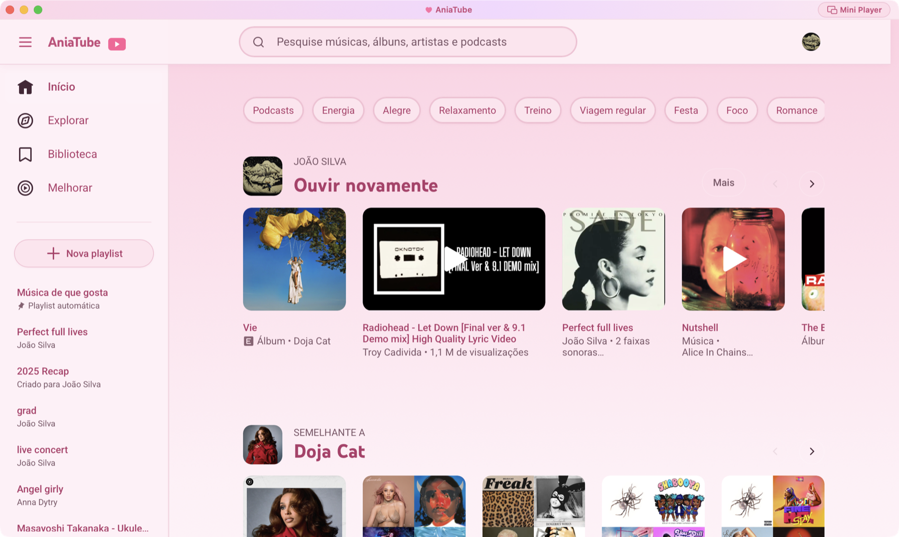
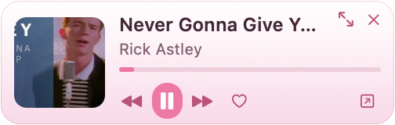
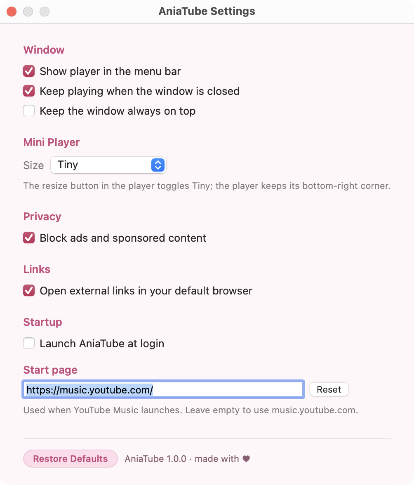

# AniaTube ♥

A pink, girly desktop player for YouTube Music — made with love for Ania.

AniaTube is a fork of [ytm-desktop](https://github.com/Joaosilva27/ytm-desktop)
that keeps every feature of the original app and wraps it in a soft blush-pink
theme: a pink titlebar, a floating pink mini player, heart-shaped like buttons,
rose accents, and a matching app icon.

<p align="center">
  
</p>

> Unofficial client. Not affiliated with, endorsed by, or sponsored by Google
> LLC. YouTube Music is a trademark of Google LLC.

## What's different from the original

- Renamed to **AniaTube** with its own bundle ID (`com.joaosilva.aniatube`), so it
  installs beside the original app and keeps a separate sign-in session.
- A soft blush-and-rose palette across the whole interface, from the native
  titlebar to the web player.
- Heart icons for likes in the mini player and the menu bar.
- A new pink app icon, "AniaTube ♥" wordmark, and "made with ♥" settings footer.
- Everything else — playback, library, ads, audio-only mode, media keys, the
  resizable mini player, and all native integrations — is unchanged.

## Install locally

AniaTube is built from source with the Xcode Command Line Tools. There is no
Xcode project to open and no third-party dependency.

```sh
git clone <this-repo> AniaTube
cd AniaTube
./Tools/build.sh --install
```

That builds `dist/AniaTube.app` and copies it to `/Applications/AniaTube.app`.
It never touches `/Applications/YouTube Music.app`.

If macOS blocks the first launch because the app is not notarized, open
**System Settings → Privacy & Security**, scroll to **Security**, and click
**Open Anyway** next to the AniaTube message. Or clear the quarantine flag:

```sh
xattr -dr com.apple.quarantine "/Applications/AniaTube.app"
```

Then open AniaTube and click **Sign in** to complete Google's sign-in flow in
the app window. Credentials are entered directly on Google's pages; the app
never reads or stores them.

### Uninstall

Quit the app, then drag **AniaTube** from Applications to the Bin. Your session
and settings live in `~/Library/WebKit/com.joaosilva.aniatube`; remove that
folder too if you want a clean slate. Turn off **Launch at login** in Settings
first if you enabled it.

## Features

- **The real YouTube Music** — no reimplementation, no missing features. Sign
  in and your playlists, uploads, likes, and history are all there.
- **Persistent session** — cookies and site data live in the app's WebKit
  profile, so you stay signed in between launches.
- **Native window** — a real AppKit titlebar strip with an AniaTube wordmark and
  pill-shaped **Mini Player** / **Video** controls. Full screen, zoom, and
  back/forward gestures all work.
- **Now Playing integration** — Control Center, the macOS Now Playing panel,
  and hardware media keys control playback. The Mac is kept awake while music
  is playing.
- **Menu bar player** — play/pause, previous/next, a heart for likes, and quick
  access to the window, mini player, and settings.
- **Mini player** — a floating, always-on-top pink player with artwork,
  progress, and playback controls. Open it from the title bar, the View menu,
  the menu bar, or with ⌘⇧M. Tiny is the default size; use the resize button to
  toggle between Tiny and your last larger size, or choose Regular, Compact, or
  Tiny in **Settings → Mini Player**.
- **Ad blocking** — a bundled content blocker removes known ad and tracking
  requests and hides promotional surfaces. A page script also strips ad
  metadata and fast-forwards in-player ads. Control it in
  **Settings → Privacy**.
- **Audio-only by default** — playback uses YouTube's audio-only stream for the
  current track, so no music video is displayed and the player shows the track
  artwork instead. When a track has a video, click the **Video** button in the
  title bar, use **View → Show Video**, or press ⌥⌘V to switch back to the video
  stream. The next track returns to audio-only automatically.
- **Dock menu** — playback controls plus quick access to the window and mini
  player, without bringing the window forward.
- **Native settings** — start page, menu bar player, keep-playing-on-close,
  always-on-top, ad blocking, external links, mini-player size, and launch at
  login.
- **Resilient** — loading and offline states, retry, and automatic reload if
  the WebKit content process is terminated.

| Mini player | Settings |
| --- | --- |
|  |  |

## Requirements

To use the app: macOS 13 Ventura or later, Apple silicon or Intel. Nothing else.

To build it: macOS 13 or later and the Xcode Command Line Tools
(`xcode-select --install`).

## Build from source

```sh
git clone <this-repo> AniaTube
cd AniaTube
./Tools/build.sh
open "dist/AniaTube.app"
```

To build and copy the app into `/Applications` in one step:

```sh
./Tools/build.sh --install
```

The build compiles the Objective-C sources with `clang`, assembles
`dist/AniaTube.app`, copies the JavaScript resources, injects the pink web
theme, and ad-hoc signs the bundle. The app is built locally, so it is not
notarized.

To produce a distributable universal build and a drag-to-install disk image:

```sh
UNIVERSAL=1 VERSION=1.0.0 ./Tools/build.sh
./Tools/make-dmg.sh
```

`Tools/make-dmg.sh` writes `dist/AniaTube-<version>.dmg` plus a `.sha256`
checksum, with the app, an Applications shortcut, and a Finder window layout.

## How the pink theme works

- `Sources/AniaTheme.m` owns the blush palette, the titlebar/mini-player/logo
  gradients, the heart drawing helper, and the custom pill button used in the
  native chrome.
- `Resources/AniaTheme.js` is injected into the web view at document start. It
  overrides YouTube Music's light and dark design tokens, surfaces, chips,
  search, sliders, scrollbars, the wordmark, and the player bar, and re-applies
  itself after single-page navigations.
- `Sources/MainWindowController.m` paints the pink titlebar strip and brand mark.
- `Sources/MiniPlayerController.m` draws the gradient panel, heart like button,
  and pink progress/play controls.
- `Sources/LoadingOverlayView.m` provides the blush splash/loading/error screen.
- `Sources/SettingsWindowController.m` themes the native settings window.

## How it works

- `Sources/WebController.m` owns the `WKWebView`, navigation policy, the
  JavaScript bridge, and in-app Google authentication. Internal links and
  sign-in redirects stay in the app; blank scripted popups are ignored so the
  page can never be replaced by an empty black document. Google's sign-in
  handshake is also kept in-app across its country domains
  (`accounts.google.pt`, `accounts.google.co.uk`, …), which is where the
  session cookie (`SetSID`) is actually written.
- `Resources/PlayerBridge.js` reads player state from the page and exposes
  play/pause, seek, previous/next, and like commands.
- `Sources/NowPlayingService.m` publishes metadata to MediaPlayer and handles
  remote commands and sleep prevention.
- `Sources/MainWindowController.m` builds the native 28pt titlebar strip and
  the **Mini Player** button, and keeps the page below the traffic lights in
  windowed mode and edge-to-edge in full screen.
- `Sources/StatusItemController.m` and `Sources/MiniPlayerController.m` provide
  the other native surfaces.
- `Sources/AdBlocker.m` compiles the bundled WebKit content-rule list and
  attaches it to the web view. `Resources/AdBlockRules.json` blocks known ad
  hosts and YouTube ad endpoints and hides promotional UI.
- `Resources/AdBlocker.js` prunes ad fields from player responses and
  fast-forwards any in-player ads that still appear.
- `Resources/AudioOnly.js` hooks the music app's player API to request
  YouTube's `audio_only=1` stream for every queue load, swaps in the track
  artwork while that stream plays, and exposes the per-track video toggle to
  the native titlebar.
- `Sources/LoginItemManager.m` manages a LaunchAgent in
  `~/Library/LaunchAgents` for launch at login.

The WebKit view uses a persistent data store at
`~/Library/WebKit/com.joaosilva.aniatube` (plus the usual WebKit caches).

## Development

Build and run the snapshot harness used during development:

```sh
./Tools/snapshot.sh build/snapshot.png 12
```

The app also accepts hidden environment variables for local testing, including
`YTM_START_URL`,
`YTM_ACTION=mini|minibutton|minisize|settings|fullscreen|adblocktoggle|video`,
`YTM_SNAPSHOT`, `YTM_SNAPSHOT_MODE=window`, and `YTM_EPHEMERAL=1` (uses a
non-persistent WebKit profile). These are not user-facing settings.

Re-generate the app icon after editing `Tools/IconGen.m`:

```sh
./Tools/make-icon.sh
```

## Known limitations

- Playback, ads, and account behavior follow YouTube Music's web client and
  require an internet connection.
- Offline downloads and DRM-protected content are limited to what the web
  player itself supports.
- Launch at login writes a user LaunchAgent; moving the app after enabling the
  setting can leave a stale path behind. Toggle it off and on after moving the
  app.
- Some Google pages may ask you to verify the browser during sign-in. Complete
  the challenge in the app window.
- Ad blocking is best-effort: YouTube changes its ad delivery and player
  internals regularly. If playback misbehaves, turn off **Block ads and
  sponsored content** in Settings.
- Audio-only mode follows YouTube's own player availability. On the rare
  tracks where YouTube blocks audio-only playback, the player may keep using
  the video stream; the **Video** toggle remains available.

## Credits

Forked from [ytm-desktop](https://github.com/Joaosilva27/ytm-desktop) by João
Silva. The original app and this fork are MIT licensed. See [LICENSE](LICENSE).

Made with ♥ for Ania.
